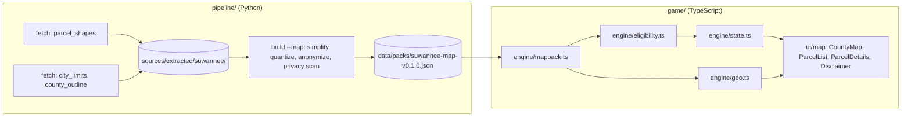

# Increment 3: county map and parcel selection (design note)

Status: **requirements, architecture and plan approved 2026-11-16; step 0
(docs) in progress.** Branch `inc3-county-map`.

## Decisions (project owner)

| Date | Decision |
|---|---|
| 2026-11-16 | Increment 3 is the Suwannee County map with selectable agricultural parcels. It replaces the earlier scope ("UI-free engine, Basic mode end to end"). The seeded random generator is deferred. |
| 2026-11-16 | Project principle: the game scores how well the player builds an agroecosystem, not profit (`docs/project-principles.md`). |
| 2026-11-16 | Real parcel boundaries, anonymized (option A). No owner, address, legal description, parcel ID or alternate key is ever downloaded or stored. Parcels are shown as P0001...; a disclaimer says they are not real listings. Option B (synthetic parcels) and C (full parcel data) not chosen. |
| 2026-11-16 | Until the county zoning layer is obtained, eligibility uses DOR land-use codes (agricultural 050-069 selectable), flagged in the review register as `parcel-eligibility-interim`. |
| 2026-11-16 | Kevin Athearn and Zachary Brym consultations deferred to the end (`docs/deferred-items.md`). |
| 2026-11-16 | Architecture approved with: shapely 2.x (pinned) in the pipeline; a separate map pack file; minimum selectable parcel 10 acres, stored in the pack. |

## Background: where farming is allowed in Suwannee County

Suwannee County Land Development Regulations (LDR, September 2014 copy;
to be checked against the current Municode text before the rules are coded):

| Zoning district | Farming allowed | Key limits |
|---|---|---|
| A-1 (rural agricultural) | All agriculture, forestry, beekeeping; intensive operations by special exception | Minimum lot 5 acres (dwellings); animal housing 100/200/300 ft from lot lines for up to 10, 11-50, over 50 animals; processing buildings 300 ft from side and rear lines |
| A-2 (agricultural near urban areas) | Non-intensive agriculture | Minimum lot 2 acres |
| ESA-1 / ESA-2 (environmentally sensitive) | Non-intensive agriculture and forestry only | Minimum lot 20 acres (ESA-1), 10 acres (ESA-2) |
| CSV (conservation) | No farming | Shown as protected neighbouring land |
| Residential, commercial, industrial (RSF, RMH, RMF, CN, CG, CI, CSC, CHI, ILW, I and others) | Not selectable | |

- "Intensive" means dairy barns, feedlots, chicken houses and holding pens.
- Setbacks in every district: 35 ft from wetlands; 75 ft from the Suwannee,
  Santa Fe and Ichetucknee Rivers; 50 ft from other perennial streams.
- Rezonings continue (for example Ordinance 2026-16, July 2026, A-1 to
  Industrial).
- Florida Statute 163.3162 bars local governments from restricting a bona fide
  farm operation on land classified as agricultural where the activity is
  covered by state best-management-practice rules.

### Zoning data: not yet available

No current machine-readable zoning layer was found (searches 2026-11-16). The
county's Official Zoning Atlas is a PDF adopted September 3, 1992, amended
October 17, 1997 (plotted 6/6/2008), so it is too old to use. The county's
public ArcGIS base map has parcels, roads, fire stations and county lines but
no zoning layer. Request the current layer from Suwannee County Planning &
Zoning (Ronald Meeks, Director, ronaldm@suwcountyfl.gov, 386-364-3401). Until
then the interim land-use-code rule applies.

## Requirements

| ID | Requirement | Priority | Acceptance criteria |
|---|---|---|---|
| F1 | Parcel boundaries fetch from the 2026 Florida Statewide Parcels layer, requesting only the shape, `DOR_UC` and `LND_SQFOOT` | Must | Saved file has no owner, address, legal-description, parcel-ID or alternate-key fields; a test shows the code refuses them even if configured; every page hashed in `fetch-lock.json` |
| F2 | Anonymized IDs P0001... in a fixed order (centroid, then area) | Must | Two builds give byte-identical IDs and pack; no real parcel ID in the pack |
| F3 | Zoning district on each parcel, with a cited source (interim: `unknown`, eligibility from land-use code) | Must | Every parcel has a district or `unknown`; source listed in `sources.json` |
| F4 | Selection rules in the engine. Interim: land-use codes 050-069 selectable; inside Live Oak or Branford, other codes, or under 10 acres blocked. With zoning: A-1/A-2 selectable; ESA-1/ESA-2 selectable as "non-intensive only"; CSV, residential, commercial, industrial, municipal, unknown blocked | Must | A blocked parcel is rejected with a reason; a restricted parcel is accepted and flagged |
| F5 | County map: outline, parcels shaded by eligibility, pan and zoom, details on click | Must | Selectable and blocked parcels differ by more than colour |
| F6 | Keyboard and screen-reader alternative: filterable parcel list | Must | Find, inspect and select a parcel by keyboard alone; axe reports no serious or critical issues |
| F7 | Selection recorded as a decision in the UI-free engine | Must | Replaying a log gives an identical state; invalid selections never enter the state |
| F8 | Soil map units per parcel with area shares | Should | Shares sum to 100% +/- 1% |
| F9 | Water and wetland setback buffers on the selected parcel | Should | Buffer drawn and its acreage shown for a parcel on a river |
| F10 | Right-to-farm note (F.S. 163.3162) in parcel details | Could | Shown in details |
| F11 | `docs/project-principles.md` | Must | Merged before scoring work starts |
| F12 | `docs/deferred-items.md` | Must | In the first commit of this increment |
| NF1 | Works offline inside the SCORM package; no external tiles or files | Must | Packaged build runs with the network blocked |
| NF2 | Map data no more than 2 MB | Must | CI size check |
| NF3 | Privacy: same rule as the `parcels` step | Must | Test scans the pack for forbidden field names and parcel-ID-like strings |
| NF4 | Other counties via region config | Should | Suwannee values only in `suwannee.json` |
| NF5 | Disclaimer: real shapes, not real listings or ownership | Must | Shown on the map screen |

**MVP:** F1-F7, F11, F12, NF1-NF3, NF5.

**Out of scope:** farming, yield, water balance and scoring; the random
generator; SCORM saving; other counties; parcels inside Live Oak and Branford;
owner and sale information (never shown or stored).

**Open assumptions:** ESA parcels selectable but non-intensive only; 10-acre
gameplay minimum (the LDR sets lot minimums for dwellings, not farm use);
unselectable parcels are still drawn as context.

## Architecture

| Component | Responsibility |
|---|---|
| `parcel_shapes.py` (new fetch step) | Server-side projection to EPSG:3086; requests geometry, `DOR_UC`, `LND_SQFOOT` only; reuses `FORBIDDEN_FIELD_PREFIXES`; strips object IDs |
| `city_limits`, `county_outline` fetch | City limits from FGDL `PAR_CITYLM_2021` (derived from 2021 FDOR parcel tax codes); Live Oak and Branford only |
| `mappack.py` (new) | Douglas-Peucker simplification, whole-metre quantization, P0001... IDs, municipal tagging, eligibility rules, validation and privacy scan |
| `schemas/mappack.schema.json` (new) | Map pack format |
| `engine/mappack.ts` | Typed loader with runtime checks |
| `engine/eligibility.ts` | `evaluate(parcel, rules)` -> selectable / restricted / blocked with reasons; rules are data |
| `engine/geo.ts` | Bounding-box grid and point-in-polygon hit test, areas |
| `engine/state.ts` | Pure `applyDecision` and `replay`; game state with `mode: 'basic' \| 'advanced'` |
| `ui/map/*` | SVG map (keyboard pan and zoom), filterable list, details, disclaimer |

Map pack: header (`schema_version`, `region`, `crs`, `units`, `sources`,
`review_flags`), `county_outline`, `municipalities`, `land_use_categories`,
`eligibility_rules` (`basis: interim_land_use`, `min_selectable_acres: 10`),
`parcels.items[]` (`id`, `acres`, `dor_uc`, `zoning`, `in_municipality`,
`bbox`, delta-encoded integer-metre rings) with collection-level `prov`.

### Risks

| Risk | Mitigation |
|---|---|
| Full county over 2 MB | Measure in step 1; stronger simplification; merge small blocked parcels into background shapes |
| Slivers between simplified neighbours | Tolerance 5 m or less; shared-edge simplification later if needed |
| City limits from 2021 | Review flag; replace with county or city data |
| Land-use codes are not zoning | Approved interim rule; review flag; shown to the player as provisional eligibility |
| shapely version drift breaks `--check` | Pin the version; quantize after simplification |

## Implementation plan

| # | Step | Status |
|---|---|---|
| 0 | Docs: this note, `project-principles.md`, `deferred-items.md` | In progress |
| 1 | Fetch steps `parcel_shapes`, `city_limits`, `county_outline`; size measurement report; review item `parcel-eligibility-interim` (with the new sources registered). Project owner runs Fetch sources once, which also rebuilds the main pack with the new review item | |
| 2 | Map pack build, schema, validation, privacy scan, CI size limit | |
| 3 | Engine: loader, eligibility, geometry, state and replay | |
| 4 | Map screen: SVG map, list, details, disclaimer; axe; offline test | |
| 5 | Spot-check, README status, merge to `main` | |

The review item moved from step 0 to step 1: the pack embeds the register, so
adding it here would fail `build --check` until the next Fetch sources run,
and its sources (city limits) are registered in step 1.
